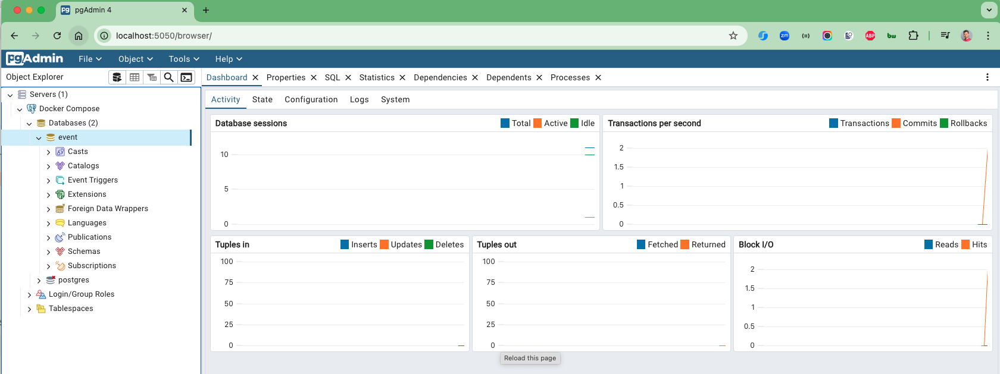

# spring-boot-pgadmin

[](https://github.com/hendisantika/spring-boot-pgadmin/actions/workflows/maven.yml)


Sample Spring Boot application that uses **Spring Boot Docker Compose support** to automatically start a
**PostgreSQL** database together with **pgAdmin 4**, so you can explore your data from the browser right away.

## Tech Stack

| Component      | Version                         |
|----------------|---------------------------------|
| Java           | 25 (Temurin)                    |
| Spring Boot    | 4.1.x                           |
| Spring Data    | JPA / Hibernate                 |
| Database       | PostgreSQL 17 (alpine)          |
| DB Admin UI    | pgAdmin 4 (`dpage/pgadmin4`)    |
| Testing        | JUnit 5, Testcontainers 2.x     |
| Build          | Maven (wrapper included)        |

## Prerequisites

- JDK 25
- Docker & Docker Compose (Docker Desktop, OrbStack, Colima, ...)
- Maven 3.9+ (optional, `./mvnw` is provided)

## Getting Started

1. Clone this repository:
   ```shell
   git clone https://github.com/hendisantika/spring-boot-pgadmin.git
   ```
2. Navigate to the folder:
   ```shell
   cd spring-boot-pgadmin
   ```
3. Run the application:
   ```shell
   ./mvnw clean spring-boot:run
   ```
   Spring Boot reads [`compose.yml`](compose.yml) and starts the `postgres` and `pgadmin` containers automatically
   (`spring.docker.compose.lifecycle-management=start_and_stop`), then stops them when the application shuts down.
4. Open pgAdmin in your favorite browser: http://localhost:5050

## Accessing the PostgreSQL Database

Verify the data directly from the database container with `docker exec`:

```shell
docker exec -it postgres17 psql -U hendisantika -d event
```

```sql
SELECT * FROM events;
```

| Property | Value          |
|----------|----------------|
| Host     | `postgres`     |
| Port     | `5432`         |
| Database | `event`        |
| Username | `hendisantika` |
| Password | `53cret`       |

## Exploring Data with pgAdmin

[pgAdmin](https://www.pgadmin.org/) is a feature-rich administration and development tool for PostgreSQL. It lets you
comfortably view tables, indexes, and data within your database.

pgAdmin runs in desktop mode (`PGADMIN_CONFIG_SERVER_MODE: "False"`), so no login is required. The server connection is
pre-registered through [`docker_pgadmin_servers.json`](docker_pgadmin_servers.json), which is mounted into the container
as `/pgadmin4/servers.json`:

```json
{
  "Servers": {
    "1": {
      "Name": "Docker Compose",
      "Group": "Servers",
      "Port": 5432,
      "Username": "hendisantika",
      "Password": "53cret",
      "Host": "postgres",
      "SSLMode": "prefer",
      "MaintenanceDB": "event",
      "PassFile": "/tmp/pgpassfile"
    }
  }
}
```

The container entrypoint writes the password into `/tmp/pgpassfile`, so every time you restart the application you will
be connected to PostgreSQL automatically — no need to add the server or type the password again.

If you prefer to add a server manually, use `postgres` as the hostname, or find the container IP:

```shell
docker ps
docker inspect postgres17 | grep IPAddress
```

## Running Tests

Integration tests use [Testcontainers](https://testcontainers.com/) with Spring Boot `@ServiceConnection` to spin up a
throwaway PostgreSQL container, so Docker must be running:

```shell
./mvnw verify
```

## Project Structure

```
.
├── compose.yml                      # PostgreSQL + pgAdmin services
├── docker_pgadmin_servers.json      # pre-registered pgAdmin server
├── src/main/java/.../event          # Event entity & repository
├── src/main/resources               # application.properties
├── src/test/java/...                # Testcontainers integration tests
└── .github
    ├── dependabot.yml               # Maven, GitHub Actions & Docker Compose updates
    └── workflows/maven.yml          # CI: build & test on JDK 25
```

## CI/CD & Dependency Updates

- **GitHub Actions** builds and tests the project on JDK 25 for every push and pull request to `main`, and submits the
  Maven dependency graph to GitHub.
- **Dependabot** keeps Maven dependencies, GitHub Actions, and Docker Compose images up to date, with grouped pull
  requests (Spring Boot, Testcontainers, Maven plugins, minor & patch updates).

## PGAdmin UI


